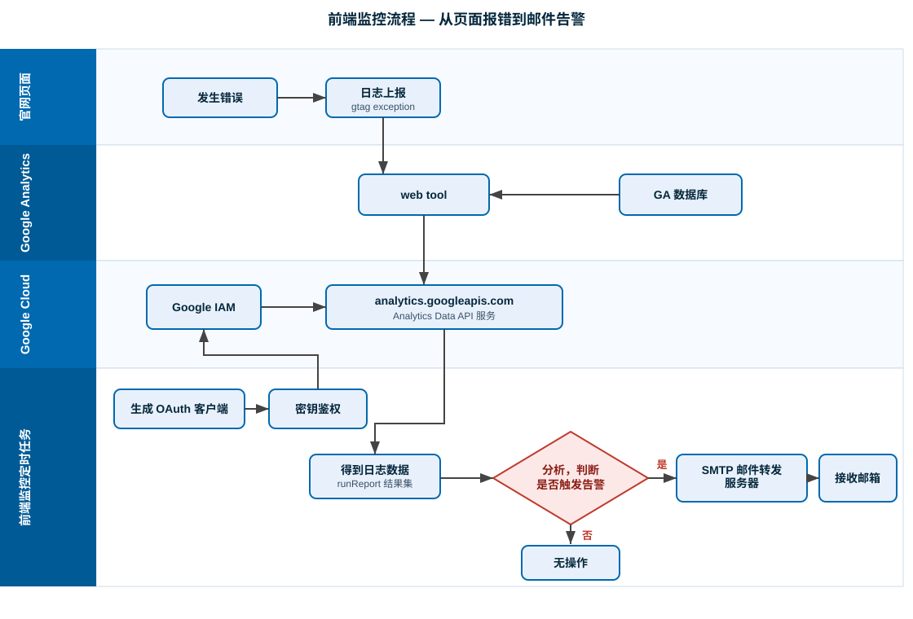
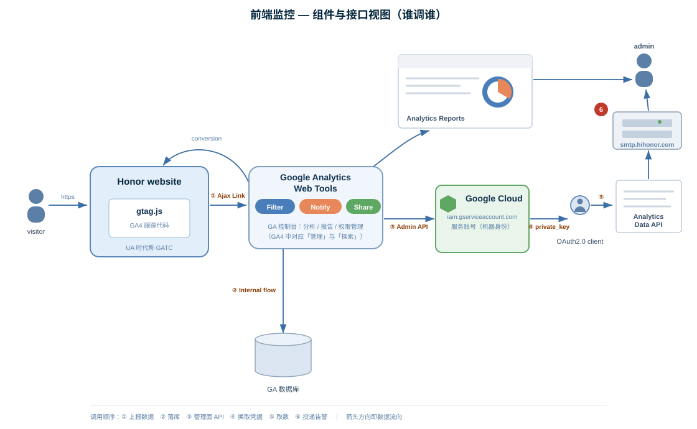

# GA实现JS监控告警专项

## 前端监控流程

::: info 一句话概括

官网各页面通过 GTM 的 `gtm-datalayer.js` 注册全局 `window.onerror` 监听，把 JS 报错按页面类型封装成 GA 的 **`errorTraceEvent`** 事件（分 **L1 / L2** 两级）上报；运维侧的**定时任务**用 Google Cloud 服务账号，通过 **Core Reporting API（UA v3）** 拉取当日 `errorTraceEvent` 数据，按小时、按等级判定（**L1 > 2 或 L2 > 5**），命中则经 **`smtp.hihonor.com`** 发邮件给「官网 IT」。

整条链路横跨 **官网页面 / Google Analytics / Google Cloud / 运维定时任务** 四层，核心仍是：**采集在 GA，判定在自有服务**。

:::

### 方案全景

上报什么 → 怎么取数 → 怎么告警 → 效果如何：

| PPT               | 主题                | 解决的核心问题                     |
| ----------------- | ------------------- | ---------------------------------- |
| ① JS 错误日志上报 | 事件等级 + 上报流程 | 报什么、按什么规则分级、前端怎么接 |
| ② GA 告警数据查询 | 服务账号 + 查询时序 | 定时任务怎么合法拿到 GA 数据       |
| ③ 邮箱告警        | API 响应 + 告警流程 | 拿到数据后怎么判定、邮件怎么发     |
| ④ 效果展示        | 报表 + 告警邮件样例 | 最终落地的样子                     |



四条泳道对应四个责任方，每个泳道只干一件事，通过「上报」和「查询」两种动作串起来：

| 泳道             | 承担方                                  | 职责                                        | 产出                                 |
| ---------------- | --------------------------------------- | ------------------------------------------- | ------------------------------------ |
| 官网页面         | 浏览器 + GTM `gtm-datalayer.js`         | 捕获 `window.onerror`、按页面类型分级、上报 | `errorTraceEvent` 事件               |
| Google Analytics | UA 媒体资源（web tool + GA 数据库）     | 接收上报、落库、提供可视化查看              | 可被查询的错误日志数据               |
| Google Cloud     | Google IAM + `analytics.googleapis.com` | 校验调用方身份、对外提供数据查询入口        | 鉴权通过后的 Core Reporting API 响应 |
| 运维定时任务     | 自有服务（定时调度）                    | 申请鉴权、拉取日志、规则判定、发送告警      | 邮件告警 / 无操作                    |



| 图中元素                                          | 实际对象                                        | 说明                                                               |
| ------------------------------------------------- | ----------------------------------------------- | ------------------------------------------------------------------ |
| `GATC`（跟踪代码框）                              | GTM / `gtm-datalayer.js` 注入的 GA 跟踪代码     | UA 时代的 `ga.js` / `analytics.js`，由 GTM 统一下发                |
| ① `Ajax Link`                                     | 浏览器向 GA 采集端点发打点请求（`/collect`）    | 走打点协议，不受跨域约束                                           |
| Google Analytics Web Tools（Filter/Notify/Share） | GA 网页控制台                                   | 人看数据 / 配置过滤与共享，不参与告警                              |
| `Analytics Reports` → `admin`                     | GA 报表页 → 订阅邮件 / 导出                     | 「人看数据」通道，与告警邮件是两条独立路径                         |
| ② `Internal flow` → `Google Database`             | GA 属性内部落库                                 | 上报数据先入 GA 存储，不可干预                                     |
| ③ `Management API`                                | Google Analytics Admin / 配置面                 | 用于服务账号授权、媒体资源配置                                     |
| `Google Cloud` / `iam.gserviceaccount.com`        | 服务账号                                        | 机器身份，`client_email` 形如 `xxx@项目ID.iam.gserviceaccount.com` |
| ④ `private_key`                                   | 服务账号 JSON 密钥中的 `private_key`            | 对 JWT 签名换短期 `access_token`，不可进代码仓库                   |
| `OAuth2.0 client`                                 | `google-auth-library` 的 JWT 客户端             | 无「用户点授权」步骤，服务账号自签名换令牌                         |
| ⑤ `Core Reporting API`                            | `analytics/v3/data/ga`（UA Core Reporting API） | 取数入口，关键参数见下文「查询参数」                               |
| ⑥ `smtp.hihonor.com`                              | 公司 SMTP 中继                                  | 出站过企业邮箱风控，发件人用专用账号 `mktcloud@hihonor.com`        |
| `admin` / 接收邮箱                                | 值班 / 「官网 IT」邮箱组                        | 建议用邮件组，避免人员变动导致告警失联                             |

## 事件等级与上报

### 事件与等级定义

- 定义一个 GA error 收集事件：**`errorTraceEvent`**。
- 基于**页面类型**划分 **L1 / L2** 两种事件等级：

| 等级   | 适用页面                                                                              | 含义                          |
| ------ | ------------------------------------------------------------------------------------- | ----------------------------- |
| **L1** | 电商主流程（`Buy` / `checkout` / `cart` / `expresscheckout`）、新品相关页面（可配置） | 高价值 / 易转化页面，阈值更严 |
| **L2** | 其他页面                                                                              | 普通页面                      |

### 上报实现

上报逻辑集中在 `honor-site.common.base` 的 **`gtm-datalayer.js`** 中：

1. 在 `gtm-datalayer.js` 里定义全局监听事件；
2. 通过 `window.onerror` 事件监听 JS 报错；
3. 根据 `errorEvent.fileName` 判断告警级别（命中电商主流程 / 新品域名 → L1，其余 → L2）。

上报时把关键信息塞进事件字段，便于后续用 Core Reporting API 查询与按小时过滤：

```js
// honor-site.common.base / gtm-datalayer.js
// 注册全局 error 监听，把 JS 报错包装成 errorTraceEvent 上报给 GA（UA 口径）
window.addEventListener(
  "error",
  function (errorEvent) {
    // 3. 根据 fileName 判断告警级别（命中电商主流程/新品域名 → L1，其余 → L2）
    var level = getLevelByFileName(errorEvent.filename); // 返回 'L1' / 'L2'

    // eventLabel 形如：javascript error,<页面URL> <行号>_<错误信息>
    var label = [
      "javascript error",
      [errorEvent.filename, errorEvent.lineno + "_" + errorEvent.message].join(
        " ",
      ),
    ].join(", ");

    if (window.ga) {
      window.ga("send", "event", {
        eventCategory: "javascript error",
        eventAction: "errorTraceEvent", // 查询过滤的关键字
        eventLabel: label,
        dimension28: level, // 自定义维度：L1 / L2 等级
        // 报错时间戳写入另一个自定义维度（查询示例里用 dimension2），用于按小时过滤
      });
    }
  },
  true, // 捕获阶段，才能拿到资源加载类错误
);
```

### 上报流程图

```
开始
→ 页面加载完成
 → 注册全局监听事件
  → Error 发生？
  └─ 否 →（继续等待）
  └─ 是 → 捕获 error 信息，划分等级（L1/L2）→ 上报错误日志 → 更新至 GA 数据库 → 结束
```

## 数据查询与鉴权

### Google Cloud 服务账号配置

在 Google Cloud 一侧要完成三件事（配额约 **50000 次/日**）：

1. 注册项目，启用 **Google Analytics API**；
2. 注册**服务账号**，生成鉴权密钥（`private_key` + `client_email`）；
3. 为服务账号添加 **GA project reader** 权限（在 GA 媒体资源的「用户管理」里把服务账号邮箱加为「读取者」）。

服务账号邮箱形如：`zzzz@xxxx.com@gcp-xxxx.iam.gserviceaccount.com`。

::: warning 授权要做两处，缺一不可

- **Google Cloud 侧**：给服务账号启用 Analytics API 并下发密钥；
- **GA 侧**：把服务账号邮箱加为媒体资源「读取者」。

只做前者、没在 GA 后台授权，调用 `Core Reporting API` 会稳定返回 `403 PERMISSION_DENIED`，且报错信息只提权限、不提 GA 后台，极易被误判成角色配错。

:::

### GA 错误日志查询时序

参与方：**运维日常监控定时任务 → GoogleAuth → Google IAM → google analytics → SMTP 邮箱**，完整时序：

| 步  | 调用方                      | 动作                                                | 失败表现                    |
| --- | --------------------------- | --------------------------------------------------- | --------------------------- |
| 1   | 定时任务 → GoogleAuth       | 注册 OAuth（服务账号邮箱、项目 ID、申请的 GA 权限） | 密钥缺失 / 格式错           |
| 2   | GoogleAuth → 定时任务       | 返回 OAuth2.0 客户端                                | —                           |
| 3   | 定时任务 → Google IAM       | `OAuth2.0 client` 鉴权（JWT 换 token）              | 401，密钥过期 / 被禁用      |
| 4   | Google IAM → 定时任务       | 鉴权成功，返回 `access_token`                       | —                           |
| 5   | 定时任务 → google analytics | `Core Reporting API`（`token` + `GAViewID`）        | 403 权限未配齐 / 429 超配额 |
| 6   | google analytics → 定时任务 | 返回 GA 数据                                        | —                           |
| 7   | 定时任务 → SMTP 邮箱        | 分析日志，触发告警条件，发送邮件通知                | 被企业邮箱风控拦截          |

### Core Reporting API 查询参数

通过 **Core Reporting API v3** 查 GA3 数据，关键参数：

```js
const { google } = require("googleapis");
const analytics = google.analytics("v3");

const res = await analytics.data.ga.get({
  auth, // 服务账号 OAuth2 client（JWT 自签名换 token）
  ids: "ga:199715317", // GA View ID（UA 属性）
  start_date: "2023-07-23",
  end_date: "2023-07-23",
  metrics: "ga:totalEvents",
  dimensions: "ga:eventLabel, ga:dimension28", // eventLabel=错误信息, dimension28=等级
  filters: "ga:eventAction==errorTraceEvent", // 只取我们的收集事件
});
```

| 参数         | 取值                              | 作用                                             |
| ------------ | --------------------------------- | ------------------------------------------------ |
| `ids`        | `ga:199715317`                    | 目标 View（UA 属性，非 GA4 的 `properties/xxx`） |
| `dimensions` | `ga:eventLabel, ga:dimension28`   | 错误明细 + 等级维度                              |
| `filters`    | `ga:eventAction==errorTraceEvent` | 过滤出收集事件，排除其它 event                   |
| `metrics`    | `ga:totalEvents`                  | 事件计数                                         |

## 邮箱告警

### API 响应结构与字段

`Core Reporting API` 返回的 `analytics#gaData` 关键字段：

```json
{
  "kind": "analytics#gaData",
  "containsSampledData": false,
  "dataLastRefreshed": "1698017809",
  "id": "https://www.googleapis.com/analytics/v3/data/ga?ids=ga:199715317&dimensions=ga:eventLabel,ga:dimension2&metrics=ga:totalEvents",
  "itemsPerPage": 1000,
  "profileInfo": {
    "profileId": "199715317",
    "accountId": "124061648",
    "webPropertyId": "UA-124061648-17"
  },
  "query": {
    "start-date": "2023-07-23",
    "end-date": "2023-07-23",
    "ids": "ga:199715317"
  },
  "rows": [
    [
      "javascript.error:https://www.hihonor.com/kz/2441 Uncaught Error",
      "1689981122013",
      "1"
    ],
    ["…", "…", "…"]
  ],
  "totalResults": 52,
  "totalsForAllResults": { "ga:totalEvents": "52" }
}
```

| 字段                  | 含义                          | 告警里怎么用                   |
| --------------------- | ----------------------------- | ------------------------------ |
| `rows[][0]`           | `ga:eventLabel`（错误明细）   | 邮件正文列出具体报错           |
| `rows[][1]`           | `ga:dimension2`（报错时间戳） | 按小时过滤当前时段日志         |
| `rows[][2]`           | `ga:totalEvents`（次数）      | 计数与阈值比较                 |
| `webPropertyId`       | `UA-124061648-17`             | 确认这是 **UA 属性**（非 GA4） |
| `containsSampledData` | 是否采样                      | `false` 表示全量，可放心判定   |

### 告警判定流程

```
Core Reporting API
  → 当前日期的错误日志
  → 利用日志时间戳过滤「当前小时」的日志集合
  → 告警条件：L1 > 2 或 L2 > 5
       ├─ 命中 → 拉起 SMTP 发送邮件服务器
       └─ 未命中 → 无操作
```

```js
const rows = res.data.rows; // [eventLabel, timestamp, totalEvents]
const hourRows = rows.filter((r) => isCurrentHour(r[1]));
const l1 = sum(hourRows.filter((r) => levelOf(r[0]) === "L1"));
const l2 = sum(hourRows.filter((r) => levelOf(r[0]) === "L2"));

if (l1 > 2 || l2 > 5) {
  await sendAlertMail({
    from: "mktcloud@hihonor.com",
    to: "官网IT",
    smtp: "smtp.hihonor.com",
    rows: hourRows,
  });
}
```

### 告警条件与邮件配置

| 配置项         | 取值                            | 说明         |
| -------------- | ------------------------------- | ------------ |
| 告警阈值（L1） | 每小时新增 L1 错误 **> 2**      | 可配置       |
| 告警阈值（L2） | 每小时新增 L2 错误 **> 5**      | 可配置       |
| 调度周期       | **5 min**（每 5 分钟跑一次）    | 可配置       |
| 发送方         | `mktcloud@hihonor.com`          | 专用发件账号 |
| 发送服务器     | `smtp.hihonor.com`（SMTP 协议） | 公司中继     |
| 接收方         | 官网 IT                         | 建议用邮件组 |

---

## 效果展示

### GA 报表中的错误分布

| 事件标签（eventLabel）                                                                                         | 日期+时间  | 事件总数  |
| -------------------------------------------------------------------------------------------------------------- | ---------- | --------- |
| javascript error, …/honor-magic5-pro/ 2_Uncaught SyntaxError: Unexpected token '<'                             | 2023072123 | 3 (2.31%) |
| javascript error, …/honor-watch-gs-3/ 4540_Uncaught TypeError: Cannot read properties of null (reading 'load') | 2023072122 | 2 (1.54%) |
| javascript error, …/honor-watch-gs-3/ 4589_Uncaught TypeError: Cannot read properties of null (reading 'load') | 2023072122 | 2 (1.54%) |
| …                                                                                                              | …          | …         |

### 告警邮件样例

触发后收到的邮件长这样：

- 标题/标识：`Honorwebsite Alert : kz`
- 发件：`mktcloud`
- 明细列表（节选）：

```
javascript error,https://www.hihonor.com/kz/phones/honor-70/ 2_Uncaught SyntaxError: Unexpected token '<' 2023-07-21 22:07:00
javascript error,https://www.hihonor.com/kz/wearables/honor-watch-gs-3/ 4540_Uncaught TypeError: Cannot read properties of null (reading 'load') 2023-07-21 22:30:07
javascript error,https://www.hihonor.com/kz/phones/honor-magic5-pro/ 2_Uncaught SyntaxError: Unexpected token '<' 2023-07-21 22:33:48
…
```

---

## 迁移与现状说明

::: warning 本方案基于 Universal Analytics（UA），并非 GA4

几个硬证据：查询走 `analytics/v3/data/ga`（Core Reporting API v3）、属性是 `webPropertyId: UA-124061648-17`、维度用 `ga:eventLabel / ga:dimension28`、上报入口在 GTM 的 `gtm-datalayer.js`、告警字段写在 `eventLabel` 里。

**UA 标准属性自 2023-07 起已停止收集新数据**，所以这套方案现在能查到的是历史数据；若要在当前环境延续「小时级 JS 错误告警」，需要迁移到 GA4，主要改造点：

| UA（现状）                                           | GA4（迁移目标）                                    | 改动点                                                                           |
| ---------------------------------------------------- | -------------------------------------------------- | -------------------------------------------------------------------------------- |
| `ga('send','event',{eventAction:'errorTraceEvent'})` | `gtag('event','errorTraceEvent',{...})`            | 事件模型从 action 改为 event name                                                |
| 等级存 `dimension28`、时间戳存 `dimension2`          | 注册为**自定义维度**（`error_level` / `error_ts`） | 需在 GA4 后台声明                                                                |
| `Core Reporting API v3`（`analytics/v3/data/ga`）    | **Analytics Data API**（`runReport`）              | 取数 SDK 与字段名全换（`ga:eventLabel` → `eventName`/`customEvent:error_label`） |
| `ids: ga:199715317`（View ID）                       | `property: properties/xxxx`                        | 不再有 View 概念                                                                 |

结论：流程骨架（采集在 GA、判定在自有服务、SMTP 投递）完全可复用，变的是**上报事件模型、自定义维度、取数 API** 这三处。

:::
