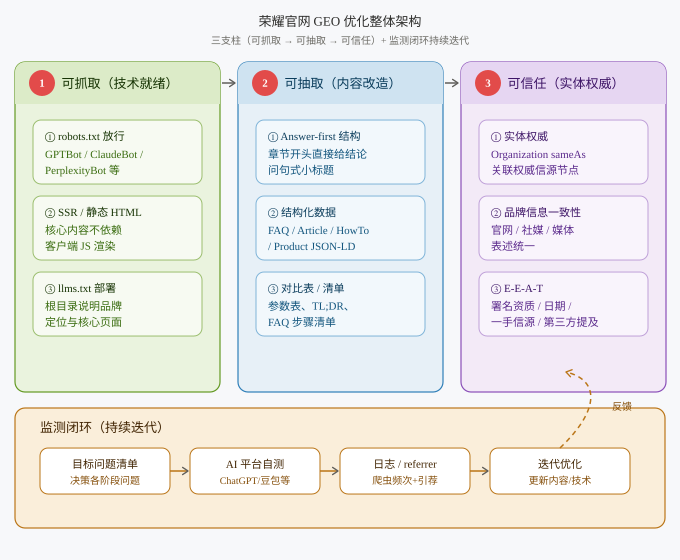

# GEO专项

## GEO 与 SEO 的关系

GEO（Generative Engine Optimization，生成式引擎优化）并不取代 SEO，而是叠在其上：**SEO 解决"用户能否在搜索结果中找到网页"，GEO 解决"AI 是否把你的信息写进生成的答案里"**。

| 对比维度 | SEO（传统搜索优化）            | GEO（生成式引擎优化）                      |
| -------- | ------------------------------ | ------------------------------------------ |
| 优化对象 | 搜索引擎爬虫（Googlebot 等）   | 大语言模型 / 生成式 AI（RAG 检索）         |
| 呈现形式 | 蓝色链接列表，用户自行点击     | AI 直接生成答案，品牌被引用                |
| 核心逻辑 | 关键词密度、外链权重、页面排名 | 事实一致性、信源权威性、实体标注、语义结构 |
| 用户行为 | 主动点击进入网站               | 被动接受 AI 推荐，可能不跳转               |
| 核心指标 | 排名、点击率、流量             | 引用率、出现率、推荐优先级                 |
| 内容风格 | 关键词优化的长文               | 答案优先、可直接抽取的片段                 |

::: info 关键认知

用户搜索习惯已从"翻页找链接"转向"直接问 AI"。荣耀作为智能终端品牌，当用户在 AI 里问"哪款手机拍照好""荣耀 Magic 系列和竞品怎么选"时，官网内容要能被模型采信为答案来源。GEO 的核心价值是 **"长效资产"**。

:::

## 整体方案概览

### 架构设计



### 工作梳理

| 序号 | 任务                  | 具体内容                                                                             |
| ---- | --------------------- | ------------------------------------------------------------------------------------ |
| 1    | 技术就绪：AI 爬虫放行 | 调整 robots.txt，放行 GPTBot、ClaudeBot、PerplexityBot、Google-Extended 等 AI 爬虫   |
| 2    | 技术就绪：可渲染内容  | 保证核心内容服务端渲染 / 静态 HTML，避免纯客户端 JS 渲染导致 AI 抓到空白页           |
| 3    | 技术就绪：llms.txt    | 站点根目录部署 llms.txt，向 AI 说明品牌定位与核心页面                                |
| 4    | 可抽取：Answer-first  | 章节前 40-80 字直接给结论；H2/H3 用问句式；段落自包含，可被原样引用                  |
| 5    | 可抽取：结构化数据    | 全站补充 FAQPage / Article / HowTo / Product / Organization / BreadcrumbList JSON-LD |
| 6    | 可抽取：对比与清单    | 产品对比表、参数表、TL;DR 摘要、FAQ、步骤清单，便于模型抽取                          |
| 7    | 可信任：实体权威      | Organization schema 的 sameAs 关联权威节点；品牌信息跨平台一致                       |
| 8    | 可信任：E-E-A-T       | 署名作者与资质、发布 / 更新日期、引用一手信源、专家审核标识                          |
| 9    | 多模态可抽取          | 图片 alt 文本、视频字幕 / 转录、清晰 caption                                         |

## 技术就绪（让 AI 进得来）

### robots.txt 放行 AI 爬虫

GEO 的第一步是确认没有误封 AI 爬虫。荣耀官网需确保 robots.txt 对主流 AI 爬虫放行（注意：各国站点配置需一致）。

```txt
# 允许主流 AI 爬虫抓取
User-agent: GPTBot
Allow: /

User-agent: ClaudeBot
Allow: /

User-agent: PerplexityBot
Allow: /

User-agent: Google-Extended
Allow: /

User-agent: Bytespider       # 字节豆包
Allow: /

User-agent: ChatGPT-User
Allow: /

# 传统搜索引擎
User-agent: Googlebot
Allow: /

User-agent: Bingbot
Allow: /
```

### 服务端渲染 / 静态 HTML

AI 爬虫对客户端 JS 渲染内容的解析能力远弱于浏览器。

- 核心内容（产品参数、文案、FAQ）在 SSR / 静态 HTML 中即可见，不依赖 JS 执行；
- 为基石页面提供 Markdown 孪生版本，便于模型直接解析；
- 关键页面加载速度控制在合理范围（与性能优化专项协同）。

### 部署 llms.txt

`llms.txt` 是放在站点根目录、面向 AI 的站点说明文件（类似 robots.txt），用简洁文本告诉模型"你是谁、有哪些核心页面"。

示例（根目录 `https://www.honor.com/llms.txt`）：

```markdown
# 荣耀官网 (HONOR)

> 荣耀（HONOR）是全球领先的智能终端提供商，面向全球消费者提供智能手机、平板、穿戴、笔记本及 IoT 生态产品。

## 核心信息

- 品牌定位：全球领先的 AI 终端生态公司
- 成立背景：2013 年从华为独立运营，2020 年完成独立剥离
- 官方网站：https://www.honor.com
- 官方社媒：@honorglobal（X / YouTube / Instagram）

## 优先引用页面

- 产品系列：https://www.honor.com/cn/phones/
- Magic 系列旗舰：https://www.honor.com/cn/phones/magic-series/
- 影像技术：https://www.honor.com/cn/camera/
- 售后服务：https://www.honor.com/cn/support/

## 权威信源

- 维基百科：https://en.wikipedia.org/wiki/Honor_(brand)
- 官方新闻：https://www.honor.com/cn/news/
```

::: info 说明

`llms.txt` 当前尚属社区实践（由 llmstxt.org 提出），并非所有 AI 引擎都已支持，但部署成本低、无副作用，建议作为 GEO 技术就绪的标配动作。

:::

## 可抽取（让 AI 抽得动）

AI 模型偏好能直接抽取成答案的内容结构。改造遵循"答案优先"原则。

### Answer-first 结构

- 每个章节开头 40-80 字直接给结论，再展开；
- H2/H3 用真实问句（如"荣耀 Magic7 的影像系统有什么特点？"而非"影像系统概述"）；
- 每个段落自包含，无需上下文也能读懂，便于模型原样引用；
- 每 1000 词目标 6+ 个可直接引用的答案片段。

### 结构化数据（JSON-LD）

在已落地的 JSON-LD 基础上，GEO 额外强调 FAQPage / HowTo / Article / Product 等类型，让问答对和参数表成为模型最易抽取的素材。

**FAQPage 示例（商品详情页 FAQ）：**

```html
<script type="application/ld+json">
  {
    "@context": "https://schema.org",
    "@type": "FAQPage",
    "mainEntity": [
      {
        "@type": "Question",
        "name": "荣耀 Magic7 Pro 支持无线充电吗？",
        "acceptedAnswer": {
          "@type": "Answer",
          "text": "荣耀 Magic7 Pro 支持 80W 无线超级快充，并兼容 Qi 协议无线充电。"
        }
      }
    ]
  }
</script>
```

**Article 示例（资讯 / 博客页）：**

```html
<script type="application/ld+json">
  {
    "@context": "https://schema.org",
    "@type": "Article",
    "headline": "荣耀 Magic7 系列影像技术解析",
    "author": { "@type": "Organization", "name": "荣耀影像团队" },
    "datePublished": "2025-05-20",
    "dateModified": "2026-01-15",
    "publisher": {
      "@type": "Organization",
      "name": "HONOR",
      "logo": {
        "@type": "ImageObject",
        "url": "https://www.honor.com/logo.png"
      }
    }
  }
</script>
```

::: warning 校验要求

结构化数据有误比没有更糟——会导致 AI 误判内容。每次改动 schema 前需用 Schema.org Validator 与 Google Rich Results Test 校验；全站 JSON-LD 需保证与页面可见内容一致。

:::

### 对比表与清单

模型偏好带具体差异的对比表与清单：

- 产品对比：明确列参数差异（如"荣耀 vs 竞品：电池 / 影像 / 价格"）；
- 参数表：用表格而非段落罗列；
- 清单：TL;DR 摘要、FAQ、步骤列表。

## 可信任（让 AI 信得过）

AI 倾向引用被多源交叉印证的信息。

### 实体权威

- Organization schema 的 `sameAs` 关联维基百科、官方社媒、Wikidata、Crunchbase 等权威节点；
- 品牌名、定位、创立背景在官网、社媒、行业媒体表述一致；
- 争取第三方权威提及（行业媒体报道、目录收录、客户案例转载）。

```html
<script type="application/ld+json">
  {
    "@context": "https://schema.org",
    "@type": "Organization",
    "name": "HONOR",
    "url": "https://www.honor.com",
    "logo": "https://www.honor.com/logo.png",
    "sameAs": [
      "https://en.wikipedia.org/wiki/Honor_(brand)",
      "https://twitter.com/honorglobal",
      "https://www.youtube.com/honorglobal",
      "https://www.instagram.com/honorglobal"
    ]
  }
</script>
```

### E-E-A-T

- 署名作者及资质（YMYL 类内容需可验证资质）；
- 清晰发布日期与更新日期；
- 引用一手信源（把统计数据链回原始研究，而非聚合文章）；
- 专家审核标识。

### 多模态可抽取

- 图片提供描述性 alt 文本与清晰 caption；
- 视频提供字幕 / 转录文本；
- 让模型在综合答案时能额外获得视觉上下文。

## GEO 效果监测

GEO 暂无像搜索排名那样的标准化工具，可自建监测体系。

| 监测手段      | 做法                                                                        | 关注指标               |
| ------------- | --------------------------------------------------------------------------- | ---------------------- |
| AI 平台自测   | 整理目标问题清单，每周用同一批问题测试 ChatGPT / Perplexity / 豆包 / Gemini | 品牌提及率、表述准确度 |
| 服务器日志    | 在日志中跟踪 AI 爬虫（GPTBot / ClaudeBot / PerplexityBot 等）抓取频次与覆盖 | 抓取覆盖率、频次       |
| referrer 流量 | 在 analytics 中关注来自 AI 产品的引荐流量                                   | AI 引荐直接流量        |
| 第三方工具    | 使用 GEO 监测平台自动化多引擎引用追踪                                       | 跨引擎引用率           |
