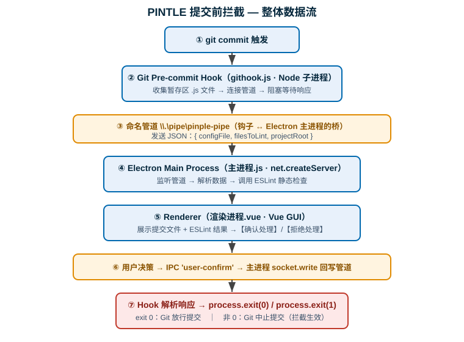

# PINTLE专项

## 业务背景

::: info PINTLE 是什么

**PINTLE 是一个基于 Electron 实现的桌面端工具，用于在代码提交前（pre-commit）做拦截式检查。**

它把「代码规范 / 质量校验」前置到 `git commit` 动作真正发生之前：当开发者执行提交时，PINTLE 会拦截提交流程，对本次将要提交的代码做静态检查（demo 以 ESLint 为例），再通过图形界面让开发者确认或拒绝，最终决定提交能否放行。

:::

**核心价值：**

- 把质量门禁从「提交后 CI 报错再返工」前移到「提交前本地即时拦截」，缩短反馈链路。
- 相比纯命令行脚本，桌面端 GUI 能直观展示待提交文件、检查结果与决策按钮，体验更好。
- 相比绑定具体 IDE 的插件，Electron 桌面端跨平台、与编辑器解耦，团队统一成本低。
- AEM项目不属于常规前后端项目无法直接使用插件，需要自定义实现。

## 整体架构设计



::: info 四大角色（对应 4 个 demo 文件）

| 文件           | 进程 / 角色                   | 职责                                                                     |
| -------------- | ----------------------------- | ------------------------------------------------------------------------ |
| `githook.js`   | Git 钩子客户端（Node 子进程） | `git commit` 时被触发，收集暂存文件，连接命名管道把数据发给 Electron     |
| `主进程.js`    | Electron 主进程               | 用 `net` 模块监听命名管道，解析请求，调用 ESLint，并把用户决策回写给钩子 |
| `渲染进程.vue` | Electron 渲染进程（Vue GUI）  | 接收主进程转发的数据，展示待提交内容与检查结果，提供「确认 / 拒绝」按钮  |
| `eslint.js`    | 检查能力模块                  | 基于 ESLint 编程式 API 对目标文件做静态检查，返回错误 / 警告统计         |

:::

整条链路由一根 **命名管道（Named Pipe）** 串起来：`\\.\pipe\pinple-pipe`。它既是 Git 钩子与 Electron 主进程之间的通信桥梁，也是让钩子「卡住等待用户操作」的关键。

## 核心实现原理：提交前拦截是如何发生的

**真正的「拦截器」是 Git 的 pre-commit 钩子，而不是 Electron。**

Git 在执行 `git commit` 时会调用 `.git/hooks/pre-commit` 脚本，并**以该脚本的退出码决定提交能否继续**：

- 退出码为 `0` → Git 认为检查通过，**正常提交**；
- 退出码非 `0` → Git 认为检查失败，**中止本次提交**。

Electron 桌面端在这里扮演的是「带图形界面的检查 + 决策前端」：

1. 钩子脚本启动后，不自己画界面，而是连上命名管道，把待提交文件信息发给早已运行着的 Electron 主进程；
2. 主进程跑 ESLint，把结果和文件清单推给渲染进程（Vue 窗口）；
3. 开发者在窗口里点「确认处理」或「拒绝处理」；
4. 决策经 IPC 回到主进程，主进程再通过管道把结果写回给钩子；
5. 钩子依据结果 `process.exit(0)` 或 `process.exit(1)`，**由退出码真正完成「放行 / 拦截」**。

::: warning 为什么需要「管道」而不是直接在钩子里检查

Git 钩子运行在**无界面的终端 / CLI 上下文**里，无法弹出富图形界面；而 Electron 渲染进程需要**常驻**才能随时响应。两者生命周期完全不同。命名管道让「短命的钩子进程」与「常驻的 GUI 进程」解耦通信，并让钩子用阻塞等待的方式，把「用户的图形化决策」转译成最终的退出码。没有这层桥，钩子要么没有 GUI，要么每次提交都要冷启动一个 GUI（慢且浪费）。

:::

## 关键代码拆解

### Git 钩子客户端 — `githook.js`

```js
const net = require("net");
const PIPE_PATH = "\\\\.\\pipe\\pinple-pipe";
const client = net.createConnection(PIPE_PATH, () => {
  // 将待检查 js 文件、eslint 配置文件和项目根目录通过 json 格式传递至 electron 主进程
  const FILES_TO_SUBMIT = process.argv
    .slice(2)
    .filter((file) => /.(js)$/.test(file));
  const messageObj = {
    configFile: CONFIG_FILE,
    filesToLint: FILES_TO_SUBMIT,
    projectRoot: PROJECT_ROOT,
  };
  client.write(JSON.stringify(messageObj));
});

client.on("data", (data) => {
  try {
    handleMessage(data); // 有效返回值：submit | cancel | quit
  } catch (e) {
    console.error("解析响应失败:", e);
  }
});

function handleMessage(data) {
  switch (data.event) {
    case "submit":
      if (data.data.allowSubmit) {
        console.log("检查通过");
        process.exit(0);
      } else {
        console.error("检查不通过，请修改后重新提交");
        process.exit(1);
      }
      break;
    case "cancel":
      console.error("提交已取消");
      process.exit(1);
      break;
    case "quit":
      process.exit(1);
      break;
    default:
      break;
  }
}
```

**要点：**

- `process.argv.slice(2)` 拿到的是 Git 传给 pre-commit 钩子的暂存文件列表，脚本只过滤出 `.js` 文件。
- 通过 `net.createConnection(PIPE_PATH)` 连接命名管道，把 `{ configFile, filesToLint, projectRoot }` 以 JSON 发出。
- 收到主进程回写的数据后，按 `event` 字段决定退出码：**这是拦截真正生效的地方**（`exit(0)` 放行，`exit(1)` 拦截 / 取消 / 退出）。

### Electron 主进程 — `主进程.js`

```js
import { app, BrowserWindow, ipcMain } from "electron";
import net from "net";
import path from "path";

let mainWindow;
const PIPE_PATH = "\\\\.\\pipe\\pinple-pipe";

function createWindow() {
  mainWindow = new BrowserWindow({
    webPreferences: {
      preload: path.join(__dirname, "preload.js"),
      contextIsolation: true,
    },
  });
  mainWindow.loadFile("dist/index.html");
}

app.whenReady().then(() => {
  createWindow();
  const server = net.createServer(async (socket) => {
    let receivedData = "";
    socket.on("data", async (data) => {
      receivedData += data.toString();
      try {
        const receivedObj = JSON.parse(receivedData);
        mainWindow.webContents.send("pipe-data", receivedObj);
        if (receivedObj.filePath) {
          const lintResult = await lintFiles(receivedObj.xxx);
          mainWindow.webContents.send("eslint-result", lintResult);
        }
        ipcMain.once("user-confirm", (_, result) => {
          socket.write(result);
        });
        receivedData = "";
      } catch {}
    });
  });
  server.listen(PIPE_PATH);
});
```

**要点：**

- 主进程创建 `BrowserWindow`（Vue 渲染进程），并通过 `preload.js` + `contextIsolation: true` 做安全的 IPC 暴露。
- 用 `net.createServer(...).listen(PIPE_PATH)` 在命名管道上起一个服务端，**反向接收**钩子的连接（钩子是客户端，Electron 是服务端）。
- 收到管道数据 → `webContents.send('pipe-data', ...)` 推给渲染进程 → 触发 ESLint → 等渲染进程回 `user-confirm` → 把结果 `socket.write` 回给钩子。

### 渲染进程 — `渲染进程.vue`

```vue
<script setup>
import { ref, onMounted } from "vue";
const { ipcRenderer } = require("electron");
const receivedData = ref(null);
const showButtons = ref(false);
onMounted(() => {
  ipcRenderer.on("pipe-data", (event, data) => {
    receivedData.value = data;
    showButtons.value = true;
  });
  ipcRenderer.on("pipe-result", (event, data) => {
    eslintData.value = data;
  });
});
const handleConfirm = (confirmed) => {
  ipcRenderer.send("user-confirm", confirmed);
  showButtons.value = false;
};
</script>
```

**要点：**

- 监听 `pipe-data` 渲染「待提交数据」并显示「确认处理 / 拒绝处理」按钮。
- 用户点击后通过 `ipcRenderer.send('user-confirm', confirmed)` 把决策回传主进程，再由主进程经管道回写给钩子。
- 这一层就是 PINTLE「桌面端 GUI」的落点：让拦截动作对开发者可见、可交互。

### ESLint 检查模块 — `eslint.js`

```js
const { ESLint } = require("eslint");

async function lintFiles(configPath, filePaths, projectRoot, globals = []) {
  const overrideConfig = {
    globals: globals.reduce((acc, name) => {
      if (name) acc[name] = "readonly";
      return acc;
    }, {}),
  };

  const eslint = new ESLint({
    overrideConfigFile: configPath, // 指定自定义配置文件
    overrideConfig, // 注入动态生成的全局变量
    cwd: projectRoot, // 工作目录设为项目根目录
    fix: false, // 禁用自动修复（仅检查）
  });

  const results = await eslint.lintFiles(filePaths);
  return {
    totalErrors: results.reduce((sum, r) => sum + r.errorCount, 0),
    totalWarnings: results.reduce((sum, r) => sum + r.warningCount, 0),
    fileResults: results.map((r) => ({
      filePath: r.filePath,
      messages: r.messages,
      errorCount: r.errorCount,
      warningCount: r.warningCount,
    })),
  };
}
```

**要点：**

- 使用 **ESLint 编程式 API**（`new ESLint(...)` + `lintFiles`），而不是命令行 `eslint` 调用，便于在主进程内直接拿到结构化结果。
- `overrideConfigFile` 指定项目自己的 ESLint 配置；`overrideConfig.globals` 动态注入全局变量声明，避免误报「未定义变量」。
- `fix: false` 表示**只检查不自动修复**，把是否修复 / 是否放行的决策权留给开发者。

## 小结

PINTLE = **Git pre-commit 钩子（拦截闸门）+ 命名管道（进程间桥）+ Electron GUI（可视化决策）+ ESLint（检查能力）** 的组合。它把质量门禁前置到提交前，并通过桌面端 GUI 让拦截过程对开发者可见、可交互。理解它的关键在于：拦截的「开关」是 Git 钩子的退出码，Electron 只是让这个开关「看得见、点得动」。
